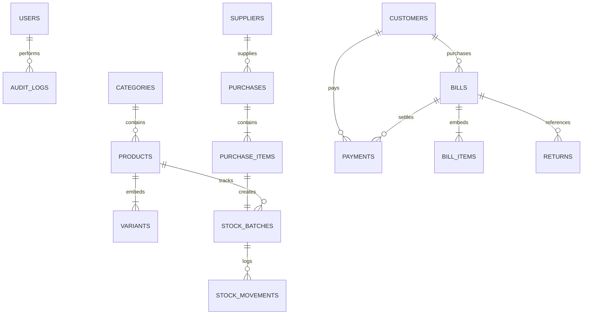

# CHAVA FITNESS CLUB ERP - DATABASE DESIGN

## 1. Principles & Standards
1. **Replica Set ACID Transactions**: Multi-document transactions used for Billing Checkout, Stock Inwarding, and Returns.
2. **Integer Currency (Paise)**: All money is stored in integer paise (`₹1.00 = 100 paise`). No floats.
3. **Soft Deletes**: `isActive: Boolean` on catalog entities. Historic references are never broken.
4. **Auditability**: `timestamps: true` across all collections; explicit `audit_logs` for sensitive overrides.
5. **FEFO Inventory**: Stock tracked by batch with expiry date. Earliest expiring valid batches sold first.

---

## 2. Entity Relationship Diagram

---

## 3. Detailed Collections Schema

### 3.1 `users`
Stores owner and staff credentials and permissions.
- `_id`: ObjectId
- `name`: String (required)
- `phone`: String (required, unique, indexed)
- `password`: String (required, bcrypt hash)
- `role`: String (enum: `['owner', 'staff']`, default: `'staff'`)
- `pin`: String (bcrypt hash of 4-6 digit owner PIN, optional)
- `isActive`: Boolean (default: `true`, indexed)
- `createdAt`: Date
- `updatedAt`: Date

### 3.2 `settings`
Single shop configuration document.
- `_id`: ObjectId
- `shopName`: String (default: `"CHAVA FITNESS CLUB"`)
- `address`: String
- `phone`: String
- `email`: String
- `gstin`: String (Indian GSTIN format)
- `state`: String (default: `"Maharashtra"`)
- `stateCode`: String (default: `"27"`)
- `billPrefix`: String (default: `"PS"`)
- `staffDiscountLimitPercent`: Number (default: `10`)
- `createdAt`: Date
- `updatedAt`: Date

### 3.3 `categories`
Supplement taxonomy categories.
- `_id`: ObjectId
- `name`: String (required, unique, indexed)
- `description`: String
- `isActive`: Boolean (default: `true`, indexed)
- `createdAt`: Date
- `updatedAt`: Date

### 3.4 `products`
Master catalog items with embedded variants.
- `_id`: ObjectId
- `name`: String (required, text indexed)
- `brand`: String (required, text indexed)
- `categoryId`: ObjectId (ref: `categories`, required, indexed)
- `hsn`: String (required, e.g., `"21069099"`)
- `gstRate`: Number (required, percentage, e.g., `18`)
- `lowStockLimit`: Number (default: `5`)
- `isActive`: Boolean (default: `true`, indexed)
- `variants`: Array of subdocuments:
  - `_id`: ObjectId
  - `flavour`: String (required, e.g., `"Double Rich Chocolate"`)
  - `size`: String (required, e.g., `"2 kg"`)
  - `sku`: String (required, unique, indexed)
  - `barcode`: String (optional, sparse unique indexed)
  - `mrp`: Integer (in paise, >= 0)
  - `sellingPrice`: Integer (in paise, <= mrp and >= 0)
  - `purchasePrice`: Integer (in paise, >= 0, stripped for staff)
  - `isActive`: Boolean (default: `true`)
- `createdAt`: Date
- `updatedAt`: Date

### 3.5 `suppliers` (Phase 2)
Supplement distributors and manufacturers.
- `_id`: ObjectId
- `name`: String (required)
- `companyName`: String
- `phone`: String (required, indexed)
- `email`: String
- `gstin`: String
- `address`: String
- `outstandingBalance`: Integer (paise, positive = shop owes supplier)
- `isActive`: Boolean (default: `true`)
- `createdAt`: Date
- `updatedAt`: Date

### 3.6 `purchases` (Phase 2)
Inward stock purchase invoices.
- `_id`: ObjectId
- `purchaseNumber`: String (unique)
- `supplierId`: ObjectId (ref: `suppliers`, required, indexed)
- `supplierInvoiceNo`: String
- `purchaseDate`: Date (required)
- `items`: Array of subdocuments:
  - `productId`: ObjectId (ref: `products`)
  - `variantId`: ObjectId
  - `batchNumber`: String
  - `mfgDate`: Date
  - `expiryDate`: Date (required)
  - `quantity`: Number (required)
  - `purchasePrice`: Integer (paise)
  - `mrp`: Integer (paise)
  - `sellingPrice`: Integer (paise)
  - `gstRate`: Number
  - `taxableAmount`: Integer (paise)
  - `gstAmount`: Integer (paise)
  - `totalAmount`: Integer (paise)
- `subtotal`: Integer (paise)
- `totalTax`: Integer (paise)
- `grandTotal`: Integer (paise)
- `paidAmount`: Integer (paise)
- `dueAmount`: Integer (paise)
- `status`: String (enum: `['received', 'pending', 'cancelled']`)
- `notes`: String
- `createdAt`: Date
- `updatedAt`: Date

### 3.7 `stock_batches` (Phase 2)
Physical stock tracking by batch and expiry.
- `_id`: ObjectId
- `productId`: ObjectId (ref: `products`, required, indexed)
- `variantId`: ObjectId (required, indexed)
- `batchNumber`: String (required)
- `mfgDate`: Date
- `expiryDate`: Date (required, indexed for FEFO)
- `purchasePrice`: Integer (paise, cost of this batch)
- `mrp`: Integer (paise)
- `sellingPrice`: Integer (paise)
- `initialQuantity`: Number (required)
- `currentQuantity`: Number (required, indexed)
- `supplierId`: ObjectId (ref: `suppliers`)
- `purchaseId`: ObjectId (ref: `purchases`)
- `status`: String (enum: `['active', 'depleted', 'expired']`, default: `'active'`)
- `createdAt`: Date
- `updatedAt`: Date
*Compound Index*: `{ productId: 1, variantId: 1, expiryDate: 1, currentQuantity: 1 }` (for optimal FEFO retrieval).

### 3.8 `stock_movements` (Phase 2)
Immutable stock ledger entries.
- `_id`: ObjectId
- `productId`: ObjectId (ref: `products`, required, indexed)
- `variantId`: ObjectId (required, indexed)
- `batchId`: ObjectId (ref: `stock_batches`, required, indexed)
- `type`: String (enum: `['purchase', 'sale', 'return', 'adjustment', 'expired']`, required)
- `quantity`: Number (required; positive for increase, negative for decrease)
- `remainingBalance`: Number (batch balance after movement)
- `referenceId`: ObjectId (ref: `purchases`, `bills`, or `returns`)
- `reason`: String
- `performedBy`: ObjectId (ref: `users`, required)
- `createdAt`: Date (indexed)

### 3.9 `customers` (Phase 3 & 4)
Customer profiles, sales history, and credit ledger.
- `_id`: ObjectId
- `name`: String (required)
- `phone`: String (required, unique, indexed)
- `email`: String
- `gstin`: String (optional, for B2B)
- `address`: String
- `outstandingDues`: Integer (paise, positive = customer owes shop)
- `totalSpent`: Integer (paise, cumulative)
- `isActive`: Boolean (default: `true`)
- `createdAt`: Date
- `updatedAt`: Date

### 3.10 `bills` (Phase 3)
Completed sales invoices (immutable).
- `_id`: ObjectId
- `billNumber`: String (required, unique, format: `PS/2627/000123`)
- `financialYear`: String (e.g., `"2627"`)
- `customerId`: ObjectId (ref: `customers`, optional for walk-in)
- `customerSnapshot`: Subdocument: `{ name, phone, gstin, state }`
- `cashierId`: ObjectId (ref: `users`, required)
- `items`: Array of subdocuments:
  - `productId`: ObjectId (ref: `products`)
  - `variantId`: ObjectId
  - `batchId`: ObjectId (ref: `stock_batches`)
  - `name`: String (snapshot)
  - `flavour`: String (snapshot)
  - `size`: String (snapshot)
  - `hsn`: String (snapshot)
  - `quantity`: Number (required)
  - `unitPrice`: Integer (paise, selling price inclusive of GST)
  - `purchasePrice`: Integer (paise, cost price snapshot for profit calculation)
  - `discountAmount`: Integer (paise)
  - `netAmount`: Integer (paise)
  - `gstRate`: Number
  - `taxableAmount`: Integer (paise)
  - `cgst`: Integer (paise)
  - `sgst`: Integer (paise)
  - `igst`: Integer (paise)
  - `total`: Integer (paise)
- `subtotal`: Integer (paise)
- `discountTotal`: Integer (paise)
- `taxableTotal`: Integer (paise)
- `cgstTotal`: Integer (paise)
- `sgstTotal`: Integer (paise)
- `igstTotal`: Integer (paise)
- `grandTotal`: Integer (paise)
- `roundOff`: Integer (paise)
- `paidAmount`: Integer (paise)
- `dueAmount`: Integer (paise)
- `paymentStatus`: String (enum: `['paid', 'partial', 'due']`)
- `paymentMode`: String (enum: `['cash', 'upi', 'card', 'split', 'credit']`)
- `idempotencyKey`: String (unique, prevents double billing)
- `status`: String (enum: `['completed', 'returned', 'cancelled']`, default: `'completed'`)
- `createdAt`: Date (indexed)
- `updatedAt`: Date

### 3.11 `counters` (Phase 3)
Atomic sequence generators for invoice numbering.
- `_id`: String (e.g., `"bill_2627"`, `"credit_note_2627"`)
- `seq`: Number (default: `0`)

### 3.12 `audit_logs`
Immutable audit register for security overrides.
- `_id`: ObjectId
- `action`: String (e.g., `'DISCOUNT_OVERRIDE'`, `'RETURN_APPROVAL'`, `'PRICE_OVERRIDE'`)
- `performedBy`: ObjectId (ref: `users`)
- `authorizedBy`: ObjectId (ref: `users`, owner who provided PIN)
- `details`: Object (metadata, previous values, new values)
- `ip`: String
- `createdAt`: Date (indexed)
