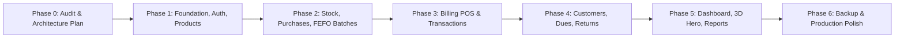

# CHAVA FITNESS CLUB ERP - DEVELOPMENT ROADMAP

## Phase Breakdown & Milestone Schedule

---

### Phase 0: Project Audit & Development Plan (COMPLETED)
- Inspect environment and repository status.
- Document system architecture (`PROJECT_ARCHITECTURE.md`), database schemas (`DATABASE_DESIGN.md`), and delivery roadmap (`DEVELOPMENT_ROADMAP.md`).
- Set workspace rules and update `PROJECT_SPEC.md`.

---

### Phase 1: Foundation, Auth, Shop Profile, Categories, Products (CURRENT MILESTONE)
- **Backend**:
  - Scaffolding: Node 20+, Express, Mongoose, Zod, bcrypt, JWT in httpOnly cookies, rate limiting, error handling.
  - Money utilities: `rupeesToPaise`, `paiseToRupees`, `formatINR`.
  - Mongoose models: `User`, `Settings`, `Category`, `Product` (with embedded `variants[]`).
  - Auth services: login, session check (`/auth/me`), logout, role checks (`owner`, `staff`).
  - Settings services: shop profile configuration, owner PIN hashing & verification.
  - Categories services: CRUD operations.
  - Products services: catalog management, variant pricing validation (`sellingPrice <= mrp`), search & pagination.
  - Security serialization: Staff response sanitizer (completely strips `purchasePrice` and profit margins).
  - Seed script: Owner account, shop profile, 8 supplement categories, ~10 realistic supplement products with flavour/size variants.
- **Frontend**:
  - Dark futuristic SaaS theme (`#080B0D` base, `#B8F36B` neon lime accents, glassmorphic cards).
  - Strict 7-item navigation sidebar (desktop) and slide-out drawer (mobile).
  - Login page with immediate status feedback.
  - Products catalog view: category filter chips, search input, responsive cards/table.
  - "Add/Edit Product" modal with dynamic variant rows (flavour, size, MRP, selling price, purchase price if owner, barcode, SKU).
  - Settings view: Shop Profile, User Management (staff list, add staff, reset password, set Owner PIN), Category Management.
  - Placeholders for Phases 2-5 modules.
- **Testing**:
  - Vitest test suite with in-memory MongoDB replica set: money utils, auth & role guards, product & variant validation, staff price concealment.

---

### Phase 2: Suppliers, Purchase Entry, Stock Batches & FEFO Ledger
- **Backend**:
  - Models: `Supplier`, `Purchase`, `StockBatch`, `StockMovement`.
  - Inward stock purchase flow: creates batch records, computes supplier balance, logs movement audit trail.
  - FEFO query service: retrieves earliest-expiry active batches for a given variant.
  - Low stock & expiry alerts calculation.
- **Frontend**:
  - Stock/Purchase view: active inventory stock view by batch and expiry date.
  - Purchase Inward entry form with multi-item batch entry (batch number, manufacturing date, expiry date, purchase price, MRP, selling price).
  - Supplier management tab and outstanding balance tracker.
  - Stock movement audit ledger view.

---

### Phase 3: Billing (POS) & Atomic Multi-Document Transactions
- **Backend**:
  - Models: `Bill`, `Counter`.
  - Checkout transaction: atomic multi-document transaction committing Bill + Payment + Stock batch decrement (FEFO) + Customer due update.
  - Financial year consecutive invoice generator (`PS/YY(YY+1)/000123`).
  - GST calculation engine (CGST + SGST vs IGST, reverse tax calculation from inclusive MRP).
  - Idempotency guard on billing endpoint.
- **Frontend**:
  - High-speed POS interface (fully responsive on phone and desktop).
  - Barcode scanner / rapid product search.
  - Cart drawer / bottom sheet on mobile.
  - Customer selection (walk-in or registered).
  - Payment split (Cash, UPI, Card, Credit).
  - Thermal / A4 receipt generation and print preview.

---

### Phase 4: Customers, Credit Dues, Returns (Credit Notes) & Day Close
- **Backend**:
  - Models: `Customer`, `Payment`, `Return`, `CashSession`.
  - Customer ledger: record credit payments and adjust outstanding balance.
  - Return / Credit Note engine: requires Owner PIN override, logs audit entry, restocks valid items.
  - Cash drawer opening & closing balance tracking.
- **Frontend**:
  - Customers view: directory, total spent, outstanding dues balance, credit payment collection modal.
  - Returns modal in billing / customer history.
  - Cash session drawer management (start day, cash drops, end day reconciliation).

---

### Phase 5: Dashboard, 3D Supplement Hero & Financial Reports
- **Backend**:
  - Analytical aggregation queries: daily sales, profit metrics (owner only), GST liability (GSTR-1 report), inventory valuation.
  - Real database metrics — strictly zero fake numbers.
- **Frontend**:
  - Futuristic 3D protein container centerpiece on Dashboard (Three.js lazy loaded, rotating particle glow, reduced-motion fallback).
  - Owner metrics: Total revenue, Gross profit, Stock valuation, Cash in drawer.
  - Staff view: Daily sales count, items sold, low stock alerts (no profit/purchase price).
  - Reports module: Daily Day-Close, Sales Summary, Tax Register (CGST/SGST/IGST breakdown), Expiry Alert Report.

---

### Phase 6: Backup, Production Polish & Hardening
- Data backup/export script (encrypted JSON/BSON dump).
- PWA / offline connectivity alert.
- Performance optimization and Lighthouse audit.
