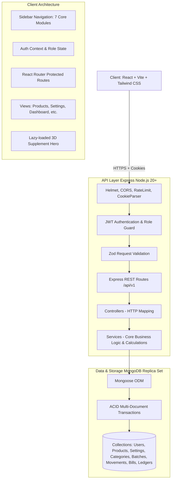

# CHAVA FITNESS CLUB ERP - PROJECT ARCHITECTURE

## 1. Executive Summary & Audit Findings
- **Repository State**: Fresh / greenfield workspace. Existing assets include only `docs/PROJECT_SPEC.md` and workspace rule `.gemini/rules/project_spec.md`. No existing legacy code or conflicting dependencies exist.
- **Environment Context**:
  - Node.js runtime: v24.13.0
  - Package manager: npm v11.6.2
  - PostgreSQL client `/opt/homebrew/bin/psql` detected.
- **Architecture Decisions**:
  - **Stack**: Node.js 20+ / Express with Mongoose & MongoDB (as specified in Master Spec with Replica Set support via Docker / Atlas `MONGODB_URI` and `mongodb-memory-server` in replica set mode for tests).
  - **Frontend**: React 18+ with Vite, Tailwind CSS, Lucide Icons, Axios, and React Router DOM.
  - **3D Centerpiece**: Three.js / React Three Fiber on Dashboard with lazy-loading, fallbacks, and motion safety.

---

## 2. System Architecture Diagram

---

## 3. Frontend Architecture

### 3.1 Technology & Tooling
- **Engine**: React + Vite (Fast HMR, optimized production chunks).
- **Styling**: Tailwind CSS with custom theme extensions matching the fixed design palette:
  - `bg-primary`: `#080B0D`
  - `bg-secondary`: `#101719`
  - `bg-card`: `#151D1F`
  - `border-theme`: `#293334`
  - `accent-primary`: `#B8F36B`
  - `accent-secondary`: `#8BD63D`
  - `text-main`: `#F5F7F4`
  - `text-muted`: `#9BA7A1`
  - `danger`: `#FF6262`
  - `warning`: `#FFB84D`
- **Routing**: `react-router-dom` with role-aware route guards (`<ProtectedRoute requireRole="owner">`).
- **State Management**: Lightweight Context API (`AuthContext`, `ToastContext`). No bloated Redux or external state stores needed.
- **HTTP Client**: Axios instance configured with `withCredentials: true` and response interceptors to handle 401 unauthenticated transitions.

### 3.2 Layout & Navigation (Strict 7 Modules)
1. **Dashboard** (`/dashboard`): Metric cards, revenue/profit overview (owner), top-selling supplements, quick POS launcher, and the lazy-loaded 3D supplement container centerpiece.
2. **Billing (POS)** (`/billing`): Fast search/scan barcode, cart with live GST breakdown, customer selection/walk-in, payment split, receipt printer. (Fully mobile-optimized).
3. **Products** (`/products`): Supplement catalog with category chips, brand/flavour/size variant manager, price editing, stock status.
4. **Stock / Purchase** (`/stock`): Inward purchase orders, batch entry with manufacturing & expiry dates, supplier linking, stock ledger audit.
5. **Customers** (`/customers`): Customer directory, purchase history, outstanding credit dues, payment ledger.
6. **Reports** (`/reports`): Daily day-close report, GST GSTR-1 outward reports, stock valuation, profit & loss (owner only), expiry alert register.
7. **Settings** (`/settings`): Shop Profile (GSTIN, bill prefix), Staff/User Management, Owner PIN security, Category master.

### 3.3 3D Supplement Hero Strategy
- **Centerpiece**: 3D revolving protein tub with glowing neon-green energy ring and ambient floating particles.
- **Implementation**:
  - Implemented using Three.js via an isolated, lazy-loaded component (`React.lazy`).
  - **Performance Guards**:
    1. Check `window.matchMedia('(prefers-reduced-motion: reduce)')` to disable animation loop.
    2. Check device pixel ratio / viewport width (<768px simplifies shaders or displays high-resolution rendered graphic).
    3. Low-overhead WebGL rendering with requestAnimationFrame throttling when tab/canvas is off-screen (IntersectionObserver).
    4. Instant SVG/WebP fallback during asset load.
    5. Strictly isolated to Dashboard — never present in high-speed Billing flow.

### 3.4 Non-Negotiable Responsive Strategy
- **Mobile First (320px+)**:
  - Navigation: Sliding mobile drawer with overlay and touch dismissal.
  - Touch Targets: All clickable targets >= 44px height and width.
  - Data Tables: Responsive card transformations on screens < 768px, or isolated horizontal scroll containers with visual fade hints.
  - Forms: Single-column inputs on phone, bottom-sheet style modals on mobile viewports for variant additions and cart checkout.
  - Safe Areas: Respects `env(safe-area-inset-bottom)` and `env(safe-area-inset-top)`.

---

## 4. Backend Architecture

### 4.1 Layered Structure
- **Routes (`/src/routes`)**: Define API paths, apply rate limiters, authentication middleware, role gates, and Zod validator middleware.
- **Controllers (`/src/controllers`)**: Handle HTTP parameters, call services, and serialize response structures (`apiResponse`).
- **Services (`/src/services`)**: Contain all business logic, transactions, calculation formulas, database interactions, and authorization checks.
- **Models (`/src/models`)**: Mongoose schemas with validation constraints, compound indexes, text indexes, and soft-delete hooks.
- **Middleware (`/src/middleware`)**: Auth JWT verification, role validation, global error handling, staff data sanitization.
- **Utils (`/src/utils`)**: Integer paise conversions, `en-IN` currency formatting, financial year calculation, invoice number generation.

### 4.2 Security & Authentication
- **Password & PIN Hashing**: bcrypt with 10 salt rounds.
- **Tokens**: Signed JSON Web Tokens containing `{ id, role }` stored in an `httpOnly`, `SameSite=lax`, `Secure` (in production) cookie.
- **Rate Limiting**: `express-rate-limit` on login endpoint (`10 requests per 15 minutes`).
- **HTTP Hardening**: `helmet` headers, strictly configured CORS with explicit origin whitelist and credentials support.
- **Staff Privacy Shield**: Server-side serializer completely strips `purchasePrice` and profit margins from all response payloads for users with the `staff` role.

---

## 5. Deployment & Environment Strategy
- **Containerization**:
  - Single-node MongoDB 7 replica set with automated initialization script (`docker-compose.yml`).
  - Production container configs for Node.js backend.
- **Cloud Database Support**:
  - Direct connection to MongoDB Atlas via `MONGODB_URI` string supporting standard replica-set connection parameters (`?retryWrites=true&w=majority`).
- **Environment Configuration**:
  - Strict validation via Zod on startup (`PORT`, `MONGODB_URI`, `JWT_SECRET`, `NODE_ENV`, `CLIENT_URL`, `DEFAULT_OWNER_PHONE`, `DEFAULT_OWNER_PASSWORD`).

---

## 6. Testing Strategy
- **Framework**: Vitest (fast, native ES modules support).
- **In-Memory Database**: `mongodb-memory-server` configured as a single-node replica set (`MongoMemoryReplSet`) to test multi-document ACID transactions without external services.
- **Test Categories**:
  1. **Unit Tests**: Currency math, paise rounding, financial year logic.
  2. **Auth & Roles Tests**: Login flow, invalid passwords, JWT issuance, staff vs. owner permissions.
  3. **Product & Validation Tests**: Variant price rules (`sellingPrice <= mrp`), unique SKU constraints.
  4. **Staff Security Tests**: Assert that `purchasePrice` is never leaked to Staff users.
  5. **Transaction & Inventory Tests (Phase 2 & 3)**: FEFO batch picking, atomic checkout, rollback on error.
