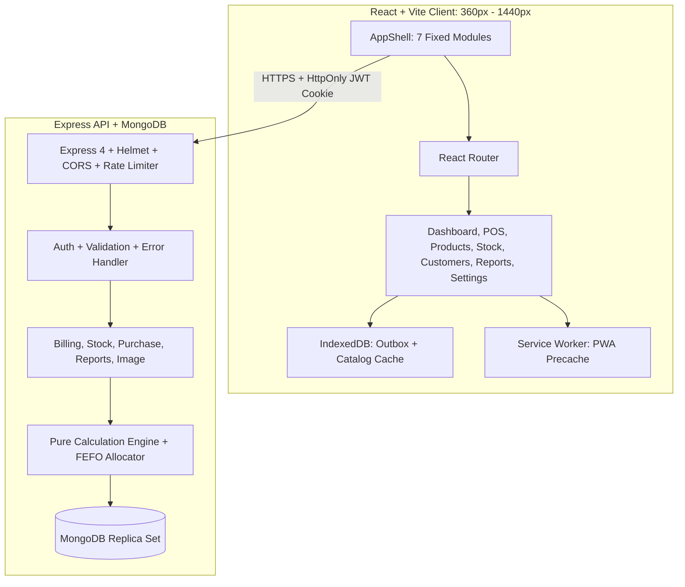

# System Architecture & Component Overview

## 1. High-Level Architecture
Chava Fitness Club ERP is a production-grade retail ERP system built for supplement retail in India. It is structured as an ES-module monorepo containing a high-throughput Node.js/Express REST API (`/server`), a responsive React/Vite single-page application (`/client`), and comprehensive documentation (`/docs`).

---

## 2. Monorepo Directory Layout
- `/server/src`:
  - `config/`: Constants, database connection, validated environment variables.
  - `controllers/`: HTTP request handlers mapping inputs to service calls.
  - `middleware/`: Authentication, owner role guard, Zod validation, global error handling.
  - `models/`: Mongoose schemas with compound indexes and unique constraints.
  - `routes/`: Express modular route definitions.
  - `services/`: Core business logic, multi-document transactions, and reporting definitions.
  - `utils/`: Integer money helpers, API responses, Unicode utilities, failpoints.
- `/client/src`:
  - `api/`: Axios client with credentials and route-specific API calls.
  - `components/`: AppShell navigation, UI design system components, 3D hero canvas.
  - `contexts/`: Global authentication state and active language context.
  - `i18n/`: Lazy-loaded English, Hindi, and Marathi locale dictionaries.
  - `pages/`: 7 primary ERP module screens.
  - `shared/offline/`: Byte-identical copy of calculation engine for offline POS.

---

## 3. Database Collections & Operational Purposes

| Collection | Operational Purpose |
|---|---|
| `users` | Staff and Owner user accounts, bcrypt hashed passwords, owner approval PINs. |
| `settings` | Shop profile, GSTIN, receipt footers, default language, offline billing feature flags. |
| `categories` | Product hierarchy classifications (e.g. Whey, Creatine, Pre-Workout). |
| `brands` | Supplement manufacturer brands with unique normalization. |
| `products` | Master supplement catalog, GST rates, HSN codes, and embedded variant definitions. |
| `stock_batches` | Physical inventory batches tracking manufacturing date, expiry date, and remaining quantities (including shortfall tracking). |
| `stock_movements` | Immutable audit ledger tracking every physical stock increment, decrement, and return. |
| `bills` | Finalized, immutable customer sales invoices with line item snapshots. |
| `payments` | Audit trail of all monetary inflows (sales, customer dues) and outflows (refunds). |
| `customers` | Customer profiles and current outstanding credit balance (`dueBalancePaise`). |
| `customer_ledger` | Immutable financial ledger recording credit sales and due payment receipts. |
| `suppliers` | Supplement wholesale vendors and distributor contact details. |
| `purchases` | Inward supplier purchase invoices linking received batches to supplier balances. |
| `supplier_payments` | Payments issued to suppliers against outstanding purchase invoices. |
| `purchase_orders` | Pre-purchase orders (POs) for inventory replenishment planning and supplier tracking. |
| `product_images` | Binary WebP image buffers (`thumb` and `medium`) stored directly in MongoDB. |
| `devices` | Registered counter POS hardware devices (Series A through E). |
| `device_series` | Sequential bill counter tracking per device and financial year. |
| `price_history` | Historical audit log of all variant selling prices, MRP, and GST rates. |
| `offline_bills_log` | Ingest log for synchronized offline bills ensuring strict idempotency. |
| `sync_issues` | Exception inbox for owner triage (oversold items, price mismatches, sequence gaps). |
| `counters` | Atomic sequence generator for online bills, purchases, and receipts. |
| `audit_logs` | Security and governance log of owner overrides, discounts, and deletions. |
